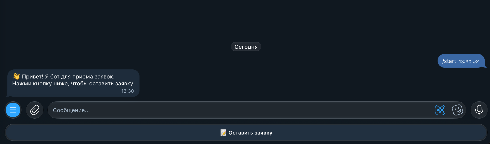
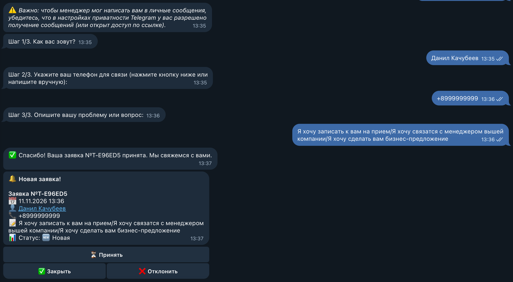
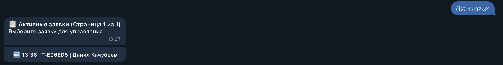
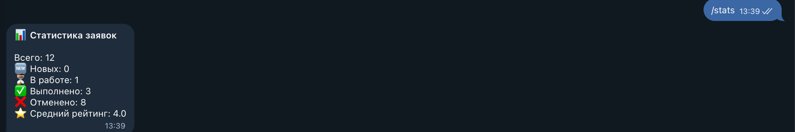

# CRM Lite Telegram Bot

Бот для приёма заявок от клиентов с автоматической выгрузкой в Google Sheets. Простое решение для малого бизнеса, фрилансеров и агентств, которым нужна лёгкая CRM прямо в Telegram — без сложных интеграций и дорогих подписок.

## 🎯 Бизнес-ценность
- **Для клиента:** удобная форма заявки в мессенджере (можно поделиться контактом в один клик), просмотр своих активных заявок, оценка качества работы.
- **Для менеджера:** все заявки автоматически падают в Google-таблицу. Уведомления о новых заявках приходят прямо в чат с кнопками управления. История и кликабельные профили клиентов под рукой.
- **Для бизнеса:** не нужна отдельная CRM-система. Базовая аналитика (количество заявок, средний рейтинг) и история обращений — всё в одном месте.

## 🚀 Функционал
- **Клиент:** пошаговая форма (FSM) для создания заявки, отправка контакта через кнопку (`request_contact`), просмотр активных заявок (`/my_tickets`), отмена действия (`/cancel`), оценка работы (1–5 звёзд).
- **Менеджер:** панель управления (`/manager`), список активных заявок с пагинацией (`/list`), статистика (`/stats`), смена статусов (Принять / Закрыть / Отклонить) из уведомления или списка.
- **Интеграции:** синхронизация с Google Sheets (Service Account), локальный кэш SQLite для быстрого доступа к данным. Фоновая подтяжка изменений из таблицы каждые 3 минуты.
- **UX/UI:** меню команд, кликабельные ссылки на профили Telegram (`tg://user?id=...`), динамические клавиатуры (кнопка «Принять» скрывается, если заявка уже в работе).

## 🛠 Стек технологий
- **Python 3.11+**
- **aiogram 3.x** — асинхронный Telegram-бот
- **Google Sheets API** (`gspread`, `google-auth`)
- **SQLite** (`aiosqlite`) — локальный кэш
- **Pydantic v2** — валидация данных и конфигурация
- **tenacity** — retry-политика для внешних вызовов
- **loguru** — логирование
- **pytest / pytest-asyncio** — тесты

## 📸 Скриншоты
| Главное меню | Процесс заявки |
| :---: | :---: |
|  |  |

| Управление заявками | Статистика |
| :---: | :---: |
|  |  |

## 📦 Установка и запуск

1. Клонируйте репозиторий:
   ```bash
   git clone https://github.com/your_username/crm-lite-bot.git
   cd crm-lite-bot
   ```

2. Создайте виртуальное окружение и установите зависимости:
   ```bash
   python3 -m venv .venv
   source .venv/bin/activate
   pip install -r requirements.txt
   ```

3. Скопируйте `.env.example` в `.env` и заполните переменные:
   - токен бота (`BOT_TOKEN`)
   - Telegram ID менеджера (`MANAGER_ID`)
   - путь к JSON-ключу сервисного аккаунта Google (`GOOGLE_CREDS_PATH`)
   - ID Google-таблицы (`SHEET_ID`)

4. Создайте Google-таблицу с листом `tickets` и колонками:
   `ticket_id | created_at | updated_at | telegram_id | name | phone | description | status | rating`

5. Запустите бота:
   ```bash
   python main.py
   ```

## 🧪 Тесты

```bash
pytest
```

Покрыты ключевые сценарии: машина статусов заявки (допустимые/недопустимые переходы) и парсинг строк из Google Sheets.

## 👤 Автор

Дамир Габдуллин / Damir Gabdullin
GitHub: https://github.com/zolasnew-creator
